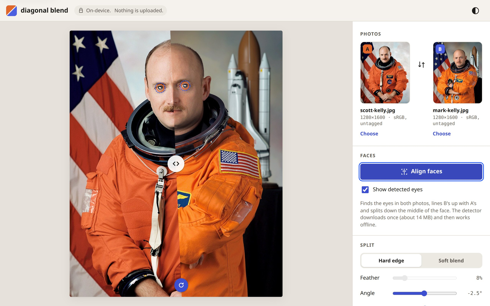
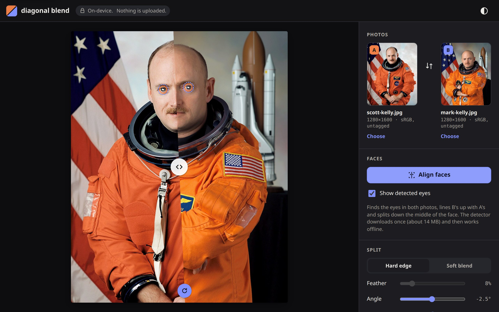

# diagonal blend

<p align="center">
  
</p>

**Two photos, one seamless diagonal.** Drop in two photos, tap *Align faces*, and get a half-and-half portrait split down the middle of the face, then export it as a full-resolution still or an animated reveal. It all runs in the browser tab. Nothing is uploaded.

**Live:** https://blend.cloud.jhaworth.ai

The core is Rust compiled to WebAssembly: geometry, colour management, EXIF and ICC parsing, the eye-alignment solve, the reveal timeline, the AVIF and PNG writers, and a [wgpu](https://wgpu.rs) renderer that uses WebGPU where the browser has it and WebGL2 where it does not, from one WGSL shader. TypeScript is only glue: the DOM, input, MediaPipe, WebCodecs and the service worker.

<p align="center">
  
  
</p>

## A two-minute tour

1. **Open it** and press *Try the sample twins*, or drop two photos onto the page. You can also paste them, pick them, or take them with the camera on a phone.
2. **Tap *Align faces*.** The face detector finds both pairs of eyes, B is scaled, turned and moved so its eyes sit exactly on A's, and the split moves to the middle of the face. Rings mark the eyes that were found (solid for A, dashed for B); they never appear in exports.
3. **Move the line.** Drag the white handle to slide it, or the round blue handle to turn it. Both are keyboard sliders as well: focus one and use the arrow keys, with Shift for bigger steps.
4. **Choose the edge.** *Hard edge* is exactly one pixel wide at any angle; *Soft blend* feathers it by up to half the frame's short side.
5. **Adjust either photo.** Drag on its side of the line to move it, scroll or pinch to zoom it, twist two fingers to turn it. The *Adjust a photo* sliders do the same from the keyboard.
6. **Export.** Pick a size (Instagram square, portrait or story, an X post, the source resolution, or anything custom) and a colour space, then save a PNG, WebP or AVIF. *Save video* renders the reveal, a sweep from A to B with an ease in and out and a hold at each end, as WebM or MP4.
7. **Share the settings.** The URL hash holds the split, the edge, both placements and the export options, never the photos, so a link reproduces a composition when the same two photos are loaded.
8. **Install it.** It is a PWA that works offline after the first visit. On Android, sharing two photos from the gallery to *diagonal blend* drops them straight into A and B.

## Privacy

Your photos never leave your device. They are decoded, rendered and encoded in the browser tab, and they are not stored anywhere: not on a server, not in the browser's storage (the one exception is the few seconds a shared photo spends in the service worker's cache on its way into the page). The page is served with a Content-Security-Policy whose `connect-src` is `'self'`, so it is not able to send data to any other origin even if it wanted to; the only things it fetches from its own origin are its own code, the face model and the sample photos. There is no analytics, no tracking and no cookies. The settings in the URL hash are never sent to the server by the browser.

## How it works

```
web/ (TypeScript)                         core/ (Rust → wasm32)
  main.ts     wiring, panel, files          scene.rs     the composition, input in CSS px
  stage.ts    canvas size, pointers ───────▶ geometry.rs  frame space, split line, placements
  faces.ts    MediaPipe eye landmarks ─────▶ align.rs     similarity solve, face midline
  images.ts   decode with no colour ───────▶ exif.rs      orientation from JPEG/PNG/WebP
              conversion                     icc.rs       find, classify and write ICC profiles
  export.ts   WebCodecs, muxers ───────────▶ render.rs    wgpu: WebGPU or WebGL2, tiled export
  state.ts    URL hash                       blend.wgsl   the shader
  sw.ts       offline, share target          avif.rs      AV1 key frame → AVIF
                                             encode.rs    PNG, WebP ICC, WebM colour fix
                                             timeline.rs  the reveal
```

Every pixel of an export comes from an offscreen render at the exact output size, in tiles of 2048 × 2048 so the size is not limited by the GPU's texture limit. The preview canvas and an 8K export of the same settings show the same composition, because all geometry is in *frame space*: measured from the centre of the frame in units of its short side.

## The shader maths

The fragment shader runs once per output pixel. It never looks at neighbouring pixels; everything comes from a little algebra done on the CPU.

### Signed distance to a line

The split is a line with unit normal $\hat n = (\cos\theta, \sin\theta)$, pointing into B, at offset $c$ from the centre of the frame. For a pixel centre $p$, measured in output pixels,

$$d(p) = \hat n \cdot p + k$$

is its *signed distance* to the line: negative on A's side, positive on B's, and zero on the line. Because $\hat n$ has unit length and $p$ is in pixels, $d$ is in pixels too. The CPU folds the frame centre, the offset and (for tiled exports) the tile's origin into the constant $k$, so the shader does one dot product.

### Coverage from the pixel footprint

A pixel is a small square, not a point. The share of it that lies on B's side is its *coverage*, and a correctly anti-aliased edge sets the pixel to A and B mixed in that proportion. Over a pixel, $d$ changes by its gradient, so the pixel's footprint in distance units is

$$w = \left\lVert \left(\tfrac{\partial d}{\partial x}, \tfrac{\partial d}{\partial y}\right) \right\rVert$$

which the shader reads with `dpdx` and `dpdy` (they become `dFdx` and `dFdy` in the GLSL that naga writes for WebGL2). Since $d$ is already in pixels, $w = 1$ at every angle. The coverage is then a ramp across one footprint, centred on the line:

$$t = \mathrm{smoothstep}\left(-\tfrac{w}{2},\ \tfrac{w}{2},\ d\right)$$

With no feather the transition is one pixel wide, measured across the line, whatever its angle: a vertical edge has one in-between pixel per row and a 45° edge about 1.4. There are no stairs, because the coverage is computed from the exact distance rather than sampled. The end-to-end tests check both properties on real exports: no more in-between pixels per row than one pixel of width can cross, and a sub-pixel edge position that follows a straight line to within 0.15 px.

The mix is done in linear light. Photos are uploaded as `rgba8unorm-srgb` textures, so sampling (and the mip-mapping used when a big photo is shown small) happens on linear values, and the shader applies the sRGB curve itself at the end.

### Why feather is a smoothstep on distance

Feathering widens the same ramp: half the feather width $f$ is added to each side.

$$t = \mathrm{smoothstep}\left(-\tfrac{w + f}{2},\ \tfrac{w + f}{2},\ d\right), \qquad \mathrm{smoothstep}(e_0, e_1, x) = s^2(3 - 2s),\ s = \mathrm{clamp}\left(\tfrac{x - e_0}{e_1 - e_0}, 0, 1\right)$$

Because $d$ is a true distance, the blend has the same width along the whole line, at any angle and at any output size (the feather is set as a fraction of the frame's short side and turned into pixels per render). A linear ramp would have a kink at each end of the band, where its slope jumps from 0 to $1/f$; the eye picks those up as faint lines (Mach bands). Smoothstep's slope is zero at both ends, so the band fades in and out with no visible boundary.

### The similarity solve for the eyes

A similarity transform (uniform scale, rotation and translation) has four degrees of freedom, and two point correspondences give exactly four equations, so one pair of eyes determines it. Treat points as complex numbers: the transform is $S(z) = a z + b$, where $a = s e^{i\varphi}$ carries the scale and the rotation. Requiring that B's eyes $q_1, q_2$ land on A's eyes $p_1, p_2$ gives

$$a = \frac{p_2 - p_1}{q_2 - q_1}, \qquad b = p_1 - a q_1 .$$

The eyes are the iris centres from MediaPipe's 478-point face mesh, mapped into frame space through each photo's current placement, and always in the same anatomical order, so the solve works even when one photo is upside down. Composing $S$ with B's placement gives B's new centre ($a c + b$), zoom ($|a|$ times the old) and rotation (plus $\arg a$).

The split then goes along the face's midline: the perpendicular bisector of A's eyes, through their midpoint, turned halfway back towards vertical so a tilted head still gets a natural-looking cut. Finally, if the solve has shrunk B so that it no longer fills its side of the frame, both photos are scaled up together about the eyes' midpoint by the smallest factor (found by bisection) that fills both sides, feather included. Scaling both about one point keeps the eyes on each other and leaves the midline where it is.

## Colour

- **Decoding.** The core reads each file's ICC profile. sRGB and Display P3 photos are decoded with `colorSpaceConversion: "none"`, so the texture holds the file's own values, and the shader converts them to the output space with an exact 3 × 3 matrix in linear light. Photos with any other profile (Adobe RGB and so on) are converted to sRGB by the browser.
- **Preview.** Where the display can show it, the canvas is Display P3: `colorSpace: "display-p3"` on the WebGPU swapchain, or `drawingBufferColorSpace` on WebGL2. Otherwise it falls back to sRGB.
- **Export.** You choose Display P3 or sRGB. PNGs carry an ICC profile in `iCCP`, WebPs in an `ICCP` chunk (the core promotes simple WebPs to the extended format to hold it), and AVIFs both as CICP in `colr nclx` and as an ICC profile in `colr prof`. The profiles are small ICC v4 matrix/TRC profiles that the core writes itself. Videos are tagged with CICP primaries 12 (P3) or 1 (BT.709) and the sRGB transfer.
- **EXIF orientation.** The core reads the tag from JPEG, PNG and WebP. The page probes once whether `createImageBitmap` already applied it (it decodes a two-pixel JPEG tagged as rotated), and the shader applies whatever rotation is still owed, as part of the photo's texture transform.

## Browser support

Tested with Playwright 1.64 on Linux, using software rendering (SwiftShader for Chromium, llvmpipe for Firefox).

| | Chrome / Edge | Firefox | Safari |
| --- | --- | --- | --- |
| Renderer | WebGPU, WebGL2 fallback (both tested, Chromium 156) | WebGL2 (tested, Firefox 157); WebGPU where Firefox has it | WebGPU or WebGL2 (not tested here) |
| Display P3 preview, on a P3 screen | Yes, on both backends (tested) | Yes (WebGL2 `drawingBufferColorSpace`) | Yes |
| PNG, WebP export | Yes | Yes | Yes |
| AVIF export | Yes: AV1 through WebCodecs, boxed by the core | Yes, the same way | Hidden (no AV1 encoder) |
| Video export | WebM (VP9), MP4 (H.264) | WebM (VP9), MP4 (H.264) | Where WebCodecs can encode |
| Face alignment | Yes | Yes | Yes |
| Install, offline | Yes | Offline yes; install depends on the platform | Add to Home Screen |
| Share target | Android | No | No |
| Mobile | Tested in emulation (Pixel 7) | | |

Each format and codec is feature-detected; anything the browser cannot encode is hidden.

## Lighthouse

Measured on the live site with Lighthouse 13.5 on 27 October 2026, three runs each:

| Run | Performance | Accessibility | Best practices | SEO |
| --- | --- | --- | --- | --- |
| Mobile (simulated slow 4G, 4× CPU) | 100 (99 to 100) | 100 | 100 | 100 |
| Desktop | 100 | 100 | 100 | 100 |

Mobile: first and largest contentful paint 1.0 s, total blocking time 70 ms, no layout shift. Desktop: 0.2 s, 0 ms, no layout shift.

The page paints before anything heavy loads: the 2 MB core starts downloading once the page has painted and the main thread is idle, and the GPU device is created with the first photo. Run it yourself with `make lighthouse` (or `make lighthouse URL=http://localhost:4173/`).

## Running it

You need Rust (1.95 or later), Node 24 and Python 3. Then:

```sh
make setup   # wasm32 target, wasm-bindgen-cli 0.2.129, npm packages, Playwright browsers
make dev     # build the core and start Vite on http://localhost:5173
make test    # Rust tests, TypeScript unit tests, a production build, then Playwright
make build   # the production site in dist/
```

`make test` runs the Playwright suite in six projects: Chromium on WebGPU, Chromium with WebGPU disabled (so WebGL2), Firefox on WebGL2, a Pixel 7 in emulation, and Chromium on both backends with a forced Display P3 screen profile, which checks that the preview really presents P3 values. Firefox needs a display, because headless Firefox has no GL on Linux; the Makefile uses `$DISPLAY` or `xvfb-run` when there is one and otherwise leaves Firefox out. The visual snapshots live in `tests/e2e/__snapshots__`, one set per project. The fixtures and where they came from are described in [tests/fixtures](tests/fixtures/README.md).

`BASE_URL=https://blend.cloud.jhaworth.ai npx playwright test` runs the same suite against the deployed site. Other targets: `make fixtures`, `make icons` and `make screenshots` regenerate the generated assets; `make deploy VERSION=v0.1.1` tags a release, which deploys it. How the site is hosted is in [docs/DEPLOY.md](docs/DEPLOY.md).

## Credits

The sample portraits are official NASA photographs of Scott and Mark Kelly, in the public domain. Face detection is [MediaPipe Face Landmarker](https://ai.google.dev/edge/mediapipe/solutions/vision/face_landmarker) (Apache 2.0); videos are muxed with [webm-muxer](https://github.com/Vanilagy/webm-muxer) and [mp4-muxer](https://github.com/Vanilagy/mp4-muxer) (MIT).
